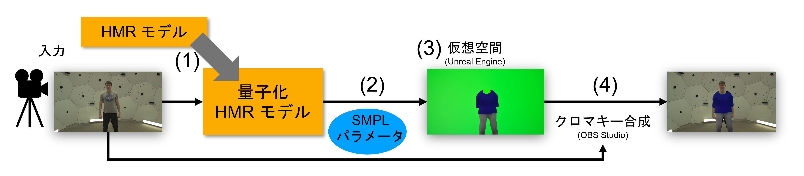

# research_repo_hmr

単眼RGB映像からのHuman Mesh Recovery（HMR）とUnreal Engineを連携させ、人物の動きに追従する映像演出を生成するコードです。

ROMP・SAT-HMR・Fast-SAM-3D-Bodyを対象に、推定精度と推論速度を比較し、量子化による高速化を検討します。推定した姿勢はSMPLに基づく共通形式へ変換し、UE上の人体・衣装・仮想物体の駆動に使用します。

## 目次

- [システム概要](#システム概要)
- [各ディレクトリの内容の概要](#各ディレクトリの内容の概要)
- [UEパッケージによる動画生成](#ueパッケージによる動画生成)
- [モデル別の環境と実行](#モデル別の環境と実行)
- [精度・速度の評価](#精度速度の評価)
- [参照リポジトリ](#参照リポジトリ)
- [ライセンス](#ライセンス)

## システム概要



UE連携では、衣装の重畳、人物の周囲を回る球による遮蔽表現、落下する岩と人体の衝突表現を扱います。

## 各ディレクトリの内容の概要

| ディレクトリ | 内容 |
|---|---|
| [ue/](ue/) | UEパッケージを使った動画推論・録画・実写との合成。UEプロジェクトはGitHub Releasesで配布 |
| [romp/](romp/) | ROMPの改変版。動画推論、量子化、UEへの姿勢配信 |
| [sat-hmr/](sat-hmr/) | SAT-HMRの改変版。INT8量子化、コンパイル、ONNX/TensorRT、UEへの姿勢配信 |
| [fast-sam-3d-body/](fast-sam-3d-body/) | Fast-SAM-3D-Bodyの改変版。TensorRTによる高速化、MHR→SMPL変換、UEへの姿勢配信 |
| [measurements/](measurements/) | 論文の計測（速度・精度・UE同時実行）の実行スクリプト、集計、図の生成 |


## UEパッケージによる動画生成

用意したUEパッケージを指定し、リポジトリのルートからカメラ推定・SAT-HMR推論・UE録画・合成動画の出力を一括で実行します。コード・モデル・標準の出力先はリポジトリの場所から解決し、推論とカメラ推定には起動したPythonを使用します。ユーザー名、condaの配置場所、WSLの名前を設定する必要はありません。

### 環境の準備

CUDA対応のNVIDIA GPU、conda、Git、FFmpeg（ffmpegとffprobe）を用意し、リポジトリのルートで実行します。

```bash
conda env create -f ue/environment.yml
conda activate hmr
python -m pip install --no-build-isolation chumpy==0.70
```

chumpyにはPython 3.11・NumPyとの互換修正が必要です。[互換修正手順](sat-hmr/docs/fix_chumpy.md)を作成した環境に適用し、次のコマンドで確認します。

```bash
python -c 'import torch, chumpy; from moge.model.v2 import MoGeModel; assert torch.cuda.is_available()'
```

この環境はSAT-HMRとMoGeを同じPythonで使用する構成です。MoGeと関連ライブラリはGitの特定コミットを指定しています。後述のモデル別環境は使用しません。

### モデルの取得と配置

バイナリ重みはGit追跡外のため、clone後に取得・配置してください。

| 資産 | 取得元 | 配置先 |
|---|---|---|
| SAT-HMR `sat_644.pth` | [SAT-HMR公式配布](https://huggingface.co/ChiSu001/SAT-HMR/tree/main/weights/sat_hmr) | `sat-hmr/weights/sat_hmr/sat_644.pth` |
| SMPL male / female | [SMPL公式サイト](https://smpl.is.tue.mpg.de/) | `body_models/smpl/SMPL_MALE.pkl`、`SMPL_FEMALE.pkl` |
| SMPL neutral | [SMPLify公式サイト](http://smplify.is.tue.mpg.de/) | `body_models/smpl/SMPL_NEUTRAL.pkl` |
| SMPL補助データ | [SAT-HMR公式のGoogle Drive](https://drive.google.com/drive/folders/1wmd_pjmmDn3eSl3TLgProgZgCQZgtZIC?usp=sharing) | 同フォルダに `smpl_mean_params.npz`、`body_verts_smpl.npy`、`J_regressor_h36m_correct.npy` |
| MoGe-2 ViT-S normal `model.pt` | [MoGe公式モデル配布](https://huggingface.co/Ruicheng/moge-2-vits-normal/tree/main) | `checkpoints/moge2/model.pt` |

SMPLは `body_models/smpl/` の1か所にだけ置きます。SAT-HMR・ROMP・Fast-SAM-3D-Bodyはすべてここを読みます。

SMPLモデルは各公式サイトでユーザー登録し、利用条件に同意してから取得します。ダウンロードしたファイルは次のように名前を変更して配置してください。

| ダウンロードしたファイル | 配置するファイル名 |
|---|---|
| `basicModel_m_lbs_10_207_0_v1.0.0.pkl` | `SMPL_MALE.pkl` |
| `basicModel_f_lbs_10_207_0_v1.0.0.pkl` | `SMPL_FEMALE.pkl` |
| `basicModel_neutral_lbs_10_207_0_v1.0.0.pkl` | `SMPL_NEUTRAL.pkl` |

```bash
mkdir -p body_models/smpl
mv /path/to/basicModel_m_lbs_10_207_0_v1.0.0.pkl body_models/smpl/SMPL_MALE.pkl
mv /path/to/basicModel_f_lbs_10_207_0_v1.0.0.pkl body_models/smpl/SMPL_FEMALE.pkl
mv /path/to/basicModel_neutral_lbs_10_207_0_v1.0.0.pkl body_models/smpl/SMPL_NEUTRAL.pkl
```

配置後の構成は次のとおりです。

```text
body_models/smpl/
  SMPL_NEUTRAL.pkl
  SMPL_MALE.pkl
  SMPL_FEMALE.pkl
  smpl_mean_params.npz
  body_verts_smpl.npy
  J_regressor_h36m_correct.npy
```

DINOv2の単独重みは学習用です。この動画生成にはFast-SAM-3D-Body本体の重みや評価データセットも不要です。

### UEパッケージの作成

UEパッケージ（Normal・RockDrop・SphereOrbit）はSMPLを含むため配布していません。GitHub Releasesで配布しているUEプロジェクトに、[モデルの取得と配置](#モデルの取得と配置)で用意した `body_models/smpl/SMPL_FEMALE.pkl` から作った人体を配置してから作成します。

必要なもの：

- Windows 10/11、Unreal Engine 5.5.4、Visual Studio 2022（C++によるゲーム開発ワークロード）
- UEプラグイン Simple TCP UDP Socket Client（作者 Socke、プラグイン名 `SocketClient`。[Fab](https://www.fab.com/)で取得し、UE 5.5のエンジンにインストール）
- [環境の準備](#環境の準備)で作成した `hmr` 環境

手順：

1. [Releases](https://github.com/gyantic/research_repo_hmr/releases/tag/ue-project-v1) から `ue-unreal-project.zip` を取得し、Windows上の任意のフォルダに展開します。展開すると `unreal` フォルダができます。

   ```powershell
   Expand-Archive ue-unreal-project.zip -DestinationPath C:\path\to\folder
   cd C:\path\to\folder\unreal
   ```

   以降は、この `unreal` フォルダをカレントディレクトリとしたWindows PowerShellのコマンドです。UEエディタは閉じた状態で実行します。

2. エディタ用モジュールをビルドします。

   ```powershell
   powershell -ExecutionPolicy Bypass -File Tools\build-editor.ps1
   ```

3. `SMPL_FEMALE.pkl` から人体のglTFを作成し、`unreal` フォルダの `Interchange/SMPL.glb` に書き出します。`hmr` 環境で、このリポジトリのルートから実行します。WSLから実行する場合、`unreal` フォルダは `/mnt/c/path/to/folder/unreal` のように指定します。

   ```bash
   conda activate hmr
   python /path/to/folder/unreal/Tools/SMPLSetup/smpl_to_gltf.py body_models/smpl/SMPL_FEMALE.pkl /path/to/folder/unreal/Interchange/SMPL.glb
   ```

4. glTFを `/Game/SMPL` としてインポートし、受信Blueprintの人体に設定します。

   ```powershell
   powershell -ExecutionPolicy Bypass -File Tools\import-smpl.ps1
   ```

5. 3つのパッケージを作成します。`Deliverables/{Normal,RockDrop,SphereOrbit}` に出力されます。

   ```powershell
   powershell -ExecutionPolicy Bypass -File Tools\package-recording.ps1
   ```

作成したパッケージや、生成される `Interchange/SMPL.glb`・`Content/SMPL.uasset`・`Content/SMPL_Skeleton.uasset` はSMPLを含むため、再配布しないでください。衣装素材のクレジットは [ue/README.md](ue/README.md#同梱素材のクレジット) にあります。

### UEパッケージの指定

`--package` には、作成したパッケージのうち1つを指定します。指定するフォルダは次の構成です。

```text
<package>/
  package-manifest.json
  Windows/
    MyProject_ROMP.exe
    ...（パッケージのほかの同梱ファイル）
```

現在のUEパッケージはWin64用です。Windowsでは直接起動し、WSLから実行する場合はWindows相互運用を使ってUEを起動します。UEへ渡すファイルパスだけをWindows形式へ変換し、推論や合成は起動元の環境で動きます。

UE録画にはWindows版FFmpegも使用します。通常はWindowsのPATHから検出します。別の実行ファイルを使用する場合は `--recorder-ffmpeg` で指定します。推論側の `--ffmpeg`・`--ffprobe` は起動元の環境で使用する実行ファイルです。

### 実行と出力

```bash
conda activate hmr
python ue/run_video.py --package /path/to/Normal --video /path/to/input.mp4
```

`package-manifest.json` に従って演出を選びます。

標準の出力先は次のとおりです。

```text
results/ue/<演出名>/Recordings/<実行日時>/composite/final.mp4
```

`<演出名>` は `package-manifest.json` の `scene_mode` から決まり、Normal・RockDrop・SphereOrbitのいずれかになります。任意の出力先は `--output` で指定します。その他のオプションは `python ue/run_video.py --help` を参照してください。

## モデル別の環境と実行

研究・評価に使用した環境は、モデルごとの `environment.yml` に記録しています。

| モデル | 環境ファイル | 環境名 |
|---|---|---|
| ROMP | [romp/environment.yml](romp/environment.yml) | `romp_3.9` |
| SAT-HMR | [sat-hmr/environment.yml](sat-hmr/environment.yml) | `sathmr-copy` |
| Fast-SAM-3D-Body | [fast-sam-3d-body/environment.yml](fast-sam-3d-body/environment.yml) | `sam_3d_body` |

以下のようにすることで環境を再現できます。
```bash
conda env create -f <モデルのディレクトリ>/environment.yml
conda activate <環境名>
```

### 3DPWの配置

精度評価に使う3DPWは、3モデルで共用する `datasets/3dpw/` に置きます。[3DPW公式サイト](https://virtualhumans.mpi-inf.mpg.de/3DPW/)から `imageFiles` と `sequenceFiles` を取得し、各モデルの評価に必要な前処理済みの注釈ファイルを同じフォルダに加えます。

```text
datasets/3dpw/
  imageFiles/
  sequenceFiles/
  annots.npz, vibe_db/                  # ROMP（元のリポジトリの手順で作成）
  annots_smpl_{train,test}_genders.npz  # SAT-HMR（元のリポジトリの手順で取得）
```

### ROMP

[学習済みモデル](https://github.com/Arthur151/ROMP#installation)と[SMPLモデルデータ](https://github.com/Arthur151/ROMP#installation)を取得し、次の場所へ配置します。モデル、数値精度、コンパイルの条件は `measurements/romp/configs/` のYAMLとコマンド引数で指定します。

| 資産 | 配置先 |
|---|---|
| 学習済みモデル `ROMP_HRNet32_V1.pkl`、`ROMP_ResNet50_V1.pkl` | `romp/trained_models/`（YAMLの `model_path` から参照） |

ROMPは `SMPL_NEUTRAL.pkl` をそのままでは読めず、ROMP専用の形式に変換した `SMPL_NEUTRAL.pth` を読みます。変換は最初に一度だけ行います。

1. [SMPLの配置](#モデルの取得と配置)のとおり、`body_models/smpl/` に `SMPL_NEUTRAL.pkl` を置きます。
2. [ROMPの配布ページ](https://github.com/Arthur151/ROMP#installation)から `smpl_model_data.zip` を取得し、中の `J_regressor_extra.npy`、`J_regressor_h36m.npy`、`smpl_kid_template.npy` を同じ `body_models/smpl/` に置きます。変換に使う補助データです。
3. 次のコマンドで、`body_models/smpl/` の `SMPL_NEUTRAL.pkl` と補助データから、ROMP用の `SMPL_NEUTRAL.pth` と `SMPLA_NEUTRAL.pth` を同じフォルダに作ります。

```bash
conda activate romp_3.9
python -c "import runpy, sys; sys.argv = ['pack', '-source_dir=$PWD/body_models/smpl', '--save_dir=$PWD/body_models/smpl']; runpy.run_path('romp/simple_romp/romp/pack_smpl_info.py')['main']()"
```

bf16・INT8の重み（`ROMP_HRNet32_V1_bf16.pth` など）は配布されていません。`romp/tools/` のエクスポートスクリプトで `romp/trained_models/` に生成します。

```bash
conda activate romp_3.9
cd romp
PYTHONPATH="$PWD:$PWD/romp" PYOPENGL_PLATFORM=egl python romp_video_demo.py \
  --input /path/to/input.mp4 \
  --configs_yml ../measurements/romp/configs/romp_video_fp32_no_compile.yml \
  --no_render --no_save
```

`--metrics_csv` を指定するとフレームごとの推論時間を出力します。論文のROMP速度評価はこのスクリプトで計測しています。

| ファイル | 内容 |
|---|---|
| [romp/romp_video_demo.py](romp/romp_video_demo.py) | 動画入力のベンチマーク用デモ |
| [romp/romp/generator_bonebasedMesh.py](romp/romp/generator_bonebasedMesh.py) | SMPL姿勢を関節クォータニオンへ変換し、TCPでUEへ送信。推論時間の統計CSVも出力 |
| [romp/romp/generator_bonebasedMesh_UDPver.py](romp/romp/generator_bonebasedMesh_UDPver.py) | 上記のUDP版（ffmpegで12 fpsに揃えて入力） |
| `romp/tools/export_torchao_int8_backbone_romp.py`、`export_quantized_weights_romp.py` | INT8量子化重みのエクスポート |

### SAT-HMR

SAT-HMRの重み（例：`sat-hmr/weights/sat_hmr/sat_644*.pth`）とSMPLモデルは、[UE動画生成と同じ配置](#モデルの取得と配置)です。評価に使う3DPWは[3DPWの配置](#3dpwの配置)のとおりです。

```bash
conda activate sathmr-copy
cd sat-hmr
python video_demo.py \
  --input /path/to/input.mp4 \
  --weights weights/sat_hmr/sat_644.pth \
  --no_render --no_save
```

`--no_render --no_save` は描画・動画保存を省略します。量子化、コンパイル、UDP配信などの条件は `python video_demo.py --help` で確認してください。論文のSAT-HMRの速度・精度はこのスクリプトで計測しています。

| ファイル | 内容 |
|---|---|
| [sat-hmr/video_demo.py](sat-hmr/video_demo.py) | PyTorchによる動画推論。SMPL姿勢のUEへのUDP送信と描画 |
| `sat-hmr/video_demo_onnx.py`、`video_demo_trt.py` | ONNX Runtime版、TensorRT版 |
| `sat-hmr/webcam_demo.py`、`webcam_demo_trt.py` | Webカメラでの実時間推論 |
| `sat-hmr/sathmr_tcp_benchmark.py`、`sathmr_udp_benchmark.py` | 通信方式別の速度ベンチマーク |
| `sat-hmr/models/int8_attention.py`、`static_int8_fused.py`、`grouped_linear.py`、`triton_grouped_int8.py` | INT8量子化の中核（`grouped_linear.py`・`triton_grouped_int8.py` は `tools/benchmark_grouped_bbox_int8.py` で使用） |
| [sat-hmr/tools/](sat-hmr/tools/) | 量子化、ONNX/TensorRTエクスポート、キャリブレーション、3DPW評価、通信ベンチマークなど。一括実行は `run_*.sh` |
| `sat-hmr/configs/run/eval_3dpw_*.yaml`、`train_qat.yaml` | 3DPW評価・QATの設定 |

### Fast-SAM-3D-Body

SAM-3D-Body・DINOv3・MoGe・YOLOの重みとMHRモデルを公式配布元から取得し、`fast-sam-3d-body/checkpoints/` などへ配置します。MHR→SMPL変換に使う `mhr2smpl_mapping.npz` と `mhr_face_mask.ply` は、[MHR](https://github.com/facebookresearch/MHR)の `tools/mhr_smpl_conversion/assets/` から `fast-sam-3d-body/mhr2smpl/data/` へ配置します。3DPWは[3DPWの配置](#3dpwの配置)のとおりです。TensorRTエンジンは使用するGPU・実行環境に合わせて、下記の変換スクリプトで生成します。

UEへの配信には `run_publisher_ue.py` を使用します。SMPLモデル、MHR→SMPL変換モデル、対応表などの指定は `python run_publisher_ue.py --help` で確認してください。速度計測と精度評価は[精度・速度の評価](#精度速度の評価)のスクリプトで行います。

| ファイル | 内容 |
|---|---|
| [fast-sam-3d-body/run_publisher_ue.py](fast-sam-3d-body/run_publisher_ue.py) | リアルタイムSMPLパブリッシャ。ZMQ配信に加え、UEへUDP/TCP送信。INT8/TensorRTバックボーン・CUDA Graph・compileを環境変数で制御。論文のINT8 TensorRT・UE連携時の速度計測で使用 |
| `fast-sam-3d-body/mocap/realtime/ue_sender.py` | `run_publisher_ue.py` が使うUE送信モジュール |
| `fast-sam-3d-body/check_int8_layers.py` | TensorRTエンジンの各テンソルのdtype（INT8/FP16/FP32）を検査 |
| `fast-sam-3d-body/profile_components.py` | forwardのコンポーネント別の時間計測 |
| `fast-sam-3d-body/build_tensorrt.sh`、`convert_backbone_tensorrt.py`、`convert_moge_encoder_trt.py`、`convert_yolo_pose_trt.py`、`sam_3d_body/models/backbones/dinov3_tensorrt.py` | TensorRT変換 |
| [fast-sam-3d-body/mhr2smpl/multi_view/step0_infer_3dpw.py](fast-sam-3d-body/mhr2smpl/multi_view/step0_infer_3dpw.py) | 精度評価の入力となる3DPW推論サンプル（`sample_*.npz`）の生成 |

## 精度・速度の評価

論文の計測（速度・精度・UE同時実行）を実行するスクリプトと、集計・図の生成コードは [measurements/](measurements/) にモデルごとにまとめています。実行方法は [measurements/README.md](measurements/README.md) を参照してください。

| ディレクトリ・ファイル | 内容 |
|---|---|
| [measurements/romp/](measurements/romp/) | ROMPの計測の実行（`run.sh`）、UE同時実行の計測、`romp_video_demo.py` に渡す設定（`configs/`） |
| [measurements/sathmr/](measurements/sathmr/) | SAT-HMRの計測の実行（`run.sh`：速度・compile範囲・UE同時実行） |
| [measurements/fastsam/](measurements/fastsam/) | Fast-SAM-3D-Bodyの計測の実行（`run.sh`）、速度計測、3DPWの精度評価、bf16重みの作成 |
| [measurements/summarize_speed.py](measurements/summarize_speed.py) | 生データから推論時間の中央値・MADを出す |
| [measurements/paper_figures/](measurements/paper_figures/) | 論文の図2・図3・図5の生成 |

## 参照リポジトリ

以下の3個のリポジトリを元としています。

| モデル | 元のリポジトリ | 改変元コミット | 元のREADME |
|---|---|---|---|
| ROMP | [Arthur151/ROMP](https://github.com/Arthur151/ROMP) | `a8558ae` | [romp/README_UPSTREAM.md](romp/README_UPSTREAM.md) |
| SAT-HMR | [ChiSu001/SAT-HMR](https://github.com/ChiSu001/SAT-HMR) | `7b157fa` | [sat-hmr/README_UPSTREAM.md](sat-hmr/README_UPSTREAM.md) |
| Fast-SAM-3D-Body | [yangtiming/Fast-SAM-3D-Body](https://github.com/yangtiming/Fast-SAM-3D-Body) | `49b0fe0` | [fast-sam-3d-body/README_UPSTREAM.md](fast-sam-3d-body/README_UPSTREAM.md) |

## ライセンス

このリポジトリ全体に単一のライセンスはありません。各ディレクトリのコードは、下表のライセンスに従います（改変したモデルのコードは元のリポジトリのライセンス）。モデルの重み・データセット・素材は、それぞれの配布元の条件に従って各自で取得してください。これらはリポジトリにもGitHub Releasesにも含めていません。例外は衣装素材（CC BY 4.0）で、Releasesで配布しているUEプロジェクトのzipに含めています。

### コード

| 対象 | ライセンス |
|---|---|
| [romp/](romp/) | Apache License 2.0（[romp/LICENSE.md](romp/LICENSE.md)）。`romp/simple_romp/` は MIT License |
| [sat-hmr/](sat-hmr/) | Apache License 2.0（[sat-hmr/LICENSE](sat-hmr/LICENSE)） |
| [fast-sam-3d-body/](fast-sam-3d-body/) | MIT License（[fast-sam-3d-body/LICENSE](fast-sam-3d-body/LICENSE)） |
| [ue/](ue/)、[measurements/](measurements/)（本研究で作成したコード） | Apache License 2.0（[ue/LICENSE](ue/LICENSE)、[measurements/LICENSE](measurements/LICENSE)） |

### モデル・重み

| 対象 | ライセンス・条件 |
|---|---|
| SMPL | [SMPL Model License](https://smpl.is.tue.mpg.de/modellicense.html)（非商用の研究目的のみ。再配布不可） |
| SAM 3D Body のチェックポイント | SAM License |
| DINOv3 | [DINOv3 License](https://github.com/facebookresearch/dinov3) |
| MoGe / MoGe-2 | MIT License（[MoGe](https://github.com/microsoft/MoGe)、[moge-2-vits-normal](https://huggingface.co/Ruicheng/moge-2-vits-normal)） |
| MHR | Apache License 2.0（[MHR](https://github.com/facebookresearch/MHR)） |
| YOLO11（ultralytics） | AGPL-3.0 |

### データ

| 対象 | ライセンス・条件 |
|---|---|
| 3DPW | [3DPW のライセンス](https://virtualhumans.mpi-inf.mpg.de/3DPW/license.html)（非商用の研究目的のみ。第三者への提供不可） |
| CMU Panoptic Studio | [panoptic-toolbox](https://github.com/CMU-Perceptual-Computing-Lab/panoptic-toolbox) に記載の条件（非商用・研究目的のみ。利用時は論文を引用） |
| 速度計測の入力動画 | [動画AC利用規約](https://video-ac.com/terms)（商用利用・加工可。単独での再配布不可） |

データはいずれもリポジトリに含めていません。CMU Panoptic Studio はシーケンス `171026_pose1`・`171204_pose2`〜`171204_pose5` から切り出した8本のクリップのみを使用しています（[measurements/README.md](measurements/README.md#入力データ)）。速度計測の入力動画は[素材ページ](https://video-ac.com/video/1201)から各自で取得してください。

### UEプロジェクト（GitHub Releases）

| 対象 | ライセンス・条件 |
|---|---|
| UEプロジェクト・StarterContent | Unreal Engine EULA |
| SocketClient プラグイン | Fab の利用条件（プロジェクトには含めず、各自で取得） |
| 衣装（シャツ・ズボン） | CC BY 4.0（クレジットは [ue/README.md](ue/README.md#同梱素材のクレジット)） |
