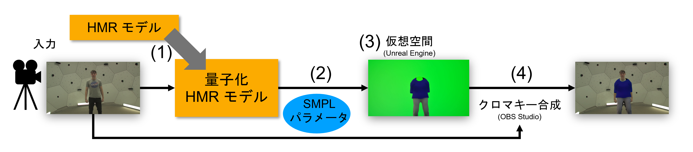

# research_repo_hmr

単眼RGB映像からのHuman Mesh Recovery（HMR）とUnreal Engine（UE）を連携させ、人物の動きに追従する映像演出を生成するシステムのリポジトリです。

本リポジトリでは、**ROMP**・**SAT-HMR**・**Fast-SAM-3D-Body** の3モデルを対象に、推定精度および推論速度の比較と、量子化（bf16 / INT8）・コンパイル（`torch.compile` / TensorRT）による高速化を検証しています。推定した人体姿勢はSMPLに基づく共通形式へ変換し、UE上の人体メッシュ・衣装・仮想物体の駆動に使用します。

## 目次

- [システム概要](#システム概要)
- [目的別の進め方](#目的別の進め方)
- [ディレクトリ構成](#ディレクトリ構成)
- [1. 環境の準備](#環境の準備)
  - [1.1 モデル別環境（ROMP / SAT-HMR / Fast-SAM-3D-Body）](#11-モデル別環境romp--sat-hmr--fast-sam-3d-body)
  - [1.2 UE動画生成用の環境（hmr）](#12-ue動画生成用の環境hmr)
  - [1.3 chumpyの互換修正（Python 3.11対応）](#13-chumpyの互換修正python-311対応)
- [2. モデルの取得と配置](#モデルの取得と配置)
  - [2.1 SMPLモデルと補助データの配置](#21-smplモデルと補助データの配置)
  - [2.2 各モデルの公式重みの配置](#22-各モデルの公式重みの配置)
  - [2.3 量子化などで作成した重みの取得](#量子化などで作成した重みの取得)
  - [2.4 計測用の重みの作成（自作する場合）](#計測用の重みの作成)
- [3. データセット・入力動画の配置](#3-データセット入力動画の配置)
  - [3.1 3DPWの配置](#3dpwの配置)
  - [3.2 速度計測の入力動画の配置](#速度計測の入力動画の配置)
  - [3.3 CMU Panoptic Studioの動画の配置](#cmu-panoptic-studioの動画の配置)
- [4. モデル別の単体推論と主要ファイル](#4-モデル別の単体推論と主要ファイル)
  - [4.1 ROMP](#41-romp)
  - [4.2 SAT-HMR](#42-sat-hmr)
  - [4.3 Fast-SAM-3D-Body](#43-fast-sam-3d-body)
- [5. UEパッケージを使用した動画の作成](#ueパッケージを使用した動画の作成)
  - [5.1 UEパッケージの作成](#ueパッケージの作成)
  - [5.2 実行と出力（合成動画の生成）](#実行と出力)
  - [5.3 SAT-HMR（INT8）からUEへの実時間送信](#sat-hmrint8からueへの実時間送信)
- [6. 精度・速度の評価](#精度速度の評価)
  - [6.1 計測の実行と論文の図](#計測の実行と論文の図)
- [参照リポジトリ](#参照リポジトリ)
- [ライセンス](#ライセンス)

---

## システム概要



入力映像から推定したSMPL姿勢を用いてUE上のアセットを駆動し、実写映像と合成することで以下の3種類の映像演出を生成します。

- **Normal**：人物の動きに追従する3D衣装の重畳
- **SphereOrbit**：人物の周囲を公転する球体による前後関係の遮蔽（オクルージョン）表現
- **RockDrop**：落下する岩と人体の衝突（物理インタラクション）表現

## 目的別の進め方

用途に応じて、以下の手順を上から順に進めてください（特に記載がない限り、コマンドは**リポジトリのルートディレクトリ**で実行します）。

- **UEパッケージを使って入力動画から演出合成動画を作りたい場合**
  1. [1.2 UE動画生成用の環境（hmr）](#12-ue動画生成用の環境hmr) と [1.3 chumpyの互換修正](#13-chumpyの互換修正python-311対応)
  2. [2.1 SMPLモデル](#21-smplモデルと補助データの配置)（`SMPL_NEUTRAL.pkl`・`SMPL_FEMALE.pkl`・SAT-HMR用補助データ）と [2.2 公式重み](#22-各モデルの公式重みの配置)（SAT-HMR `sat_644.pth`・MoGe-2 `model.pt`）の配置
  3. [5. UEパッケージを使用した動画の作成](#ueパッケージを使用した動画の作成)
- **各モデルの単体推論や、論文の精度・速度評価を再現したい場合**
  1. [1. 環境の準備](#環境の準備) → [2. モデルの取得と配置](#モデルの取得と配置) → [3. データセット・入力動画の配置](#3-データセット入力動画の配置)
  2. 単体推論は [4. モデル別の単体推論と主要ファイル](#4-モデル別の単体推論と主要ファイル)、論文実験の再現は [6. 精度・速度の評価](#精度速度の評価) を実行

---

## ディレクトリ構成

| ディレクトリ | 内容 |
|---|---|
| [ue/](ue/) | UEパッケージを用いた動画推論・録画・実写映像との合成スクリプト（UEプロジェクト本体はGitHub Releasesで配布） |
| [romp/](romp/) | ROMPの改変版（bf16化、`torch.compile`、UEへの姿勢送信機能を追加） |
| [sat-hmr/](sat-hmr/) | SAT-HMRの改変版（bf16化・INT8量子化、`torch.compile`、TensorRT対応、UEへの姿勢送信機能を追加） |
| [fast-sam-3d-body/](fast-sam-3d-body/) | Fast-SAM-3D-Bodyの改変版（bf16化・TensorRTによるINT8量子化、`torch.compile`、MHR→SMPL変換、UEへの姿勢送信機能を追加） |
| [measurements/](measurements/) | 論文用の各種計測（推論速度・推定精度・UE同時実行時の負荷）、結果の集計、および論文図表の生成スクリプト |

[2. モデルの取得と配置](#モデルの取得と配置)および[3. データセット・入力動画の配置](#3-データセット入力動画の配置)を完了した後のファイル構成は以下のとおりです。

```text
research_repo_hmr/
├── body_models/smpl/
│   ├── SMPL_NEUTRAL.pkl
│   ├── SMPL_MALE.pkl
│   ├── SMPL_FEMALE.pkl
│   ├── SMPL_NEUTRAL.pth                  # ROMP用（手順2.1で生成）
│   ├── SMPL_FEMALE.pth                   # ROMP用（手順2.1で生成）
│   ├── SMPL_MALE.pth                     # ROMP用（手順2.1で生成）
│   ├── SMPLA_NEUTRAL.pth                 # ROMP用（手順2.1で生成）
│   ├── smpl_mean_params.npz              # SAT-HMR用補助データ
│   ├── body_verts_smpl.npy               # SAT-HMR用補助データ
│   ├── J_regressor_h36m_correct.npy      # SAT-HMR用補助データ
│   ├── J_regressor_extra.npy             # ROMP用補助データ
│   ├── J_regressor_h36m.npy              # ROMP用補助データ
│   └── smpl_kid_template.npy             # ROMP用補助データ
├── checkpoints/moge2/
│   └── model.pt
├── sat-hmr/weights/sat_hmr/
│   ├── sat_644.pth
│   ├── sat_644_bf16.pth
│   ├── sat_644_int8w.pth
│   ├── sat_644_3dpw.pth
│   └── sat_644_3dpw_int8w.pth
├── romp/trained_models/
│   ├── ROMP_HRNet32_V1.pkl
│   ├── ROMP_HRNet32_V1_bf16.pth
│   ├── ROMP_HRNet32_V1_hrnet32_backbone_int8wo.pth
│   ├── ROMP_ResNet50_V1.pkl
│   ├── ROMP_ResNet50_V1_bf16.pth
│   └── ROMP_ResNet50_V1_int8_raw_weights.pth
├── fast-sam-3d-body/
│   ├── checkpoints/
│   │   ├── sam-3d-body-dinov3/
│   │   │   ├── model.ckpt
│   │   │   ├── assets/mhr_model.pt
│   │   │   └── backbone_trt/backbone_dinov3_int8.engine
│   │   ├── bf16/
│   │   │   ├── model_bf16.ckpt
│   │   │   ├── mhr_model_bf16.pt
│   │   │   └── model_bf16.pt
│   │   ├── yolo/
│   │   │   ├── yolo11m-pose.pt
│   │   │   └── yolo11m-pose.engine
│   │   └── moge_trt/
│   │       └── moge_dinov2_encoder_int8.engine
│   └── mhr2smpl/
│       ├── experiments/multiview_n30000_e500/
│       └── data/
│           ├── mhr2smpl_mapping.npz
│           └── mhr_face_mask.ply
└── datasets/
    ├── 3dpw/
    │   ├── imageFiles/
    │   ├── sequenceFiles/
    │   ├── annots.npz
    │   ├── vibe_db/
    │   ├── annots_smpl_train_genders.npz
    │   └── annots_smpl_test_genders.npz
    ├── videos/
    │   └── sample_video.mp4
    └── cmu_panoptic/
        └── person_clips/
```

---

<a id="モデル別の環境と実行"></a>
<a id="環境の準備"></a>

## 1. 環境の準備

リポジトリのルートで、用途に応じたConda環境を作成します。

### 1.1 モデル別環境（ROMP / SAT-HMR / Fast-SAM-3D-Body）

各モデルの推論・評価には、それぞれのディレクトリにある `environment.yml` から環境を作成します。

```bash
conda env create -f romp/environment.yml              # 環境名: romp_3.9
conda env create -f sat-hmr/environment.yml           # 環境名: sathmr-copy
conda env create -f fast-sam-3d-body/environment.yml  # 環境名: sam_3d_body
```

続いて、`romp_3.9` には `pytorch3d` を、`sathmr-copy` と `sam_3d_body` には `chumpy`（SMPLモデルの読み込みに使用）および `detectron2` を追加インストールします。いずれも通常のpipビルドではエラーになるため、`--no-build-isolation` オプションを付与してインストールしてください。

```bash
# ROMP環境
conda activate romp_3.9
CUDA_HOME=/usr/local/cuda-11.8 FORCE_CUDA=1 python -m pip install --no-build-isolation "git+https://github.com/facebookresearch/pytorch3d.git@0a59450f0ebbe12d9a8db3de937814932517633b"

# SAT-HMR環境
conda activate sathmr-copy
python -m pip install --no-build-isolation chumpy==0.70

# Fast-SAM-3D-Body環境
conda activate sam_3d_body
python -m pip install --no-build-isolation chumpy==0.70
python -m pip install --no-build-isolation "git+https://github.com/facebookresearch/detectron2.git@a1ce2f956a1d2212ad672e3c47d53405c2fe4312"
```

### 1.2 UE動画生成用の環境（hmr）

[5. UEパッケージを使用した動画の作成](#ueパッケージを使用した動画の作成)（`ue/run_video.py` による推論・録画・合成、およびSMPLのglTF変換）には、`ue/environment.yml` から `hmr` 環境を作成します。

```bash
conda env create -f ue/environment.yml                # 環境名: hmr
conda activate hmr
python -m pip install --no-build-isolation chumpy==0.70
```

### 1.3 chumpyの互換修正（Python 3.11対応）

`chumpy` を Python 3.11 および新しい NumPy 環境で動作させるには、互換性のためのパッチ適用が必要です。`chumpy` をインストールした環境（`sathmr-copy`、`sam_3d_body`、`hmr`）に対して、[互換修正手順（sat-hmr/docs/fix_chumpy.md）](sat-hmr/docs/fix_chumpy.md)を適用してください。

`hmr` 環境への適用後、以下のコマンドでエラーが出ないことを確認できます。

```bash
conda activate hmr
python -c 'import torch, chumpy; from moge.model.v2 import MoGeModel; assert torch.cuda.is_available()'
```

---

<a id="モデルの取得と配置"></a>

## 2. モデルの取得と配置

### 2.1 SMPLモデルと補助データの配置

#### (1) SMPL基本モデル（全モデル・UE共通）

各公式サイトからSMPLモデルをダウンロードし、以下のファイル名にリネームして `body_models/smpl/` に配置します（利用には各サイトでのアカウント登録が必要です）。

| 対象 | 取得元 | ダウンロードしたファイル名 | リネーム後の配置先 |
|---|---|---|---|
| SMPL Male / Female | [SMPL公式サイト](https://smpl.is.tue.mpg.de/) | `basicModel_m_lbs_10_207_0_v1.0.0.pkl`<br>`basicModel_f_lbs_10_207_0_v1.0.0.pkl` | `body_models/smpl/SMPL_MALE.pkl`<br>`body_models/smpl/SMPL_FEMALE.pkl` |
| SMPL Neutral | [SMPLify公式サイト](http://smplify.is.tue.mpg.de/) | `basicModel_neutral_lbs_10_207_0_v1.0.0.pkl` | `body_models/smpl/SMPL_NEUTRAL.pkl` |

```bash
mkdir -p body_models/smpl
mv /path/to/basicModel_m_lbs_10_207_0_v1.0.0.pkl body_models/smpl/SMPL_MALE.pkl
mv /path/to/basicModel_f_lbs_10_207_0_v1.0.0.pkl body_models/smpl/SMPL_FEMALE.pkl
mv /path/to/basicModel_neutral_lbs_10_207_0_v1.0.0.pkl body_models/smpl/SMPL_NEUTRAL.pkl
```

#### (2) SMPL補助データ（SAT-HMR / ROMP用）

| 用途 | 取得元 | 配置するファイル（すべて `body_models/smpl/` へ配置） |
|---|---|---|
| SAT-HMR・UE動画生成 | [SAT-HMR公式のGoogle Drive](https://drive.google.com/drive/folders/1wmd_pjmmDn3eSl3TLgProgZgCQZgtZIC?usp=sharing) | `smpl_mean_params.npz`、`body_verts_smpl.npy`、`J_regressor_h36m_correct.npy` |
| ROMP | [ROMPの配布ページ](https://github.com/Arthur151/ROMP#installation)の `smpl_model_data.zip` | `J_regressor_extra.npy`、`J_regressor_h36m.npy`、`smpl_kid_template.npy` |

#### (3) ROMP用SMPLファイルの変換（ROMPを使用する場合のみ）

ROMPは `.pkl` 形式のSMPLモデルを直接読み込めないため、上記 (1)・(2) のファイルからROMP専用形式（`SMPL_NEUTRAL.pth`・`SMPL_FEMALE.pth`・`SMPL_MALE.pth` および `SMPLA_*.pth`）を初回のみ生成します（`FEMALE`・`MALE` は3DPWの精度評価で使用します。元の手順は [romp/docs/installation.md](romp/docs/installation.md) を参照）。

```bash
conda activate romp_3.9
for gender in neutral female male; do
  python -c "import runpy, sys; sys.argv = ['pack', '-source_dir=$PWD/body_models/smpl', '--save_dir=$PWD/body_models/smpl', '--gender=$gender']; runpy.run_path('romp/simple_romp/romp/pack_smpl_info.py')['main']()"
done
```

### 2.2 各モデルの公式重みの配置

使用するモデルに応じて、各配布元から学習済み重みを取得して配置します。

| モデル・用途 | ファイル | 取得元 | 配置先 |
|---|---|---|---|
| **SAT-HMR / UE動画生成** | `sat_644.pth`、`sat_644_3dpw.pth`（3DPW評価用） | [SAT-HMR公式配布](https://huggingface.co/ChiSu001/SAT-HMR/tree/main/weights/sat_hmr) | `sat-hmr/weights/sat_hmr/` |
| **UE動画生成（MoGe-2）** | `model.pt`（ViT-S normal） | [MoGe公式モデル配布](https://huggingface.co/Ruicheng/moge-2-vits-normal/tree/main) | `checkpoints/moge2/model.pt` |
| **ROMP** | `ROMP_HRNet32_V1.pkl`、`ROMP_ResNet50_V1.pkl` | [ROMP公式配布](https://github.com/Arthur151/ROMP#installation) | `romp/trained_models/` |
| **Fast-SAM-3D-Body** | `model.ckpt`、`assets/mhr_model.pt` ほか一式 | [facebook/sam-3d-body-dinov3](https://huggingface.co/facebook/sam-3d-body-dinov3)（要利用申請） | `fast-sam-3d-body/checkpoints/sam-3d-body-dinov3/` |
| | `yolo11m-pose.pt` | [Ultralytics Releases](https://github.com/ultralytics/assets/releases/download/v8.3.0/yolo11m-pose.pt) | `fast-sam-3d-body/checkpoints/yolo/` |
| | MHR→SMPL変換モデル（`best_model.pth`、`sample_idx.npy` など） | [元リポジトリの `mhr2smpl/experiments/`](https://github.com/yangtiming/Fast-SAM-3D-Body/tree/49b0fe0/mhr2smpl/experiments) | `fast-sam-3d-body/mhr2smpl/experiments/` |
| | `mhr2smpl_mapping.npz`、`mhr_face_mask.ply` | [MHRの `tools/mhr_smpl_conversion/assets/`](https://github.com/facebookresearch/MHR) | `fast-sam-3d-body/mhr2smpl/data/` |

※ Fast-SAM-3D-Bodyが内部で使用するMoGe-2は初回実行時に自動で取得されます。

<a id="量子化などで作成した重みの取得"></a>

### 2.3 量子化などで作成した重みの取得

論文で使用したbf16・INT8の量子化重みとTensorRTエンジンは、[Hugging Face（kimurakmkm123/research_repo_hmr）](https://huggingface.co/kimurakmkm123/research_repo_hmr) で配布しています。リポジトリのルートで以下を実行すると、各モデルが読み込む所定の場所へ自動的にダウンロード・配置されます。

```bash
python download_weights.py            # 全モデルの重みを取得
python download_weights.py sathmr     # モデルを指定して取得（sathmr / romp / fastsam）
```

| モデル | 取得されるファイル | 配置先 |
|---|---|---|
| SAT-HMR | `sat_644_bf16.pth`、`sat_644_int8w.pth`、`sat_644_3dpw_int8w.pth` | `sat-hmr/weights/sat_hmr/` |
| ROMP | `ROMP_HRNet32_V1_bf16.pth`、`ROMP_ResNet50_V1_bf16.pth`、`ROMP_HRNet32_V1_hrnet32_backbone_int8wo.pth`、`ROMP_ResNet50_V1_int8_raw_weights.pth` | `romp/trained_models/` |
| Fast-SAM-3D-Body | `backbone_dinov3_int8.engine` | `fast-sam-3d-body/checkpoints/sam-3d-body-dinov3/backbone_trt/` |
| | `moge_dinov2_encoder_int8.engine` | `fast-sam-3d-body/checkpoints/moge_trt/` |
| | `yolo11m-pose.engine` | `fast-sam-3d-body/checkpoints/yolo/` |
| | `model_bf16.ckpt`、`mhr_model_bf16.pt`、`model_bf16.pt` | `fast-sam-3d-body/checkpoints/bf16/` |

> **Note:** TensorRTエンジン（`.engine`）は作成したGPU・TensorRTのバージョンでのみ読み込めます。実行環境が異なる場合は、[fast-sam-3d-body/README.md の「TensorRTエンジンの作成」](fast-sam-3d-body/README.md#tensorrtエンジンの作成)の手順で作成し直してください。

<a id="計測用の重みの作成"></a>

### 2.4 計測用の重みの作成（自作する場合）

`download_weights.py` を使わずに、[2.2 各モデルの公式重みの配置](#22-各モデルの公式重みの配置)のファイルから手元でbf16・INT8重みを生成する場合は以下を実行します。

```bash
# ROMPの量子化重み（romp_3.9環境）
conda activate romp_3.9
cd romp
python tools/export_quantized_weights_romp.py --input trained_models/ROMP_HRNet32_V1.pkl --output trained_models/
python tools/export_quantized_weights_romp.py --input trained_models/ROMP_ResNet50_V1.pkl --output trained_models/
cd ..

# SAT-HMRのbf16・INT8重み（sathmr-copy環境）
conda activate sathmr-copy
cd sat-hmr
python -c "import torch; sd = torch.load('weights/sat_hmr/sat_644.pth', map_location='cpu'); torch.save({k: v.to(torch.bfloat16) for k, v in sd.items()}, 'weights/sat_hmr/sat_644_bf16.pth')"
python tools/quantize_weights_int8.py --input weights/sat_hmr/sat_644.pth --output weights/sat_hmr/sat_644_int8w.pth
python tools/quantize_weights_int8.py --input weights/sat_hmr/sat_644_3dpw.pth --output weights/sat_hmr/sat_644_3dpw_int8w.pth
cd ..
```

Fast-SAM-3D-BodyのTensorRTエンジン作成手順は [fast-sam-3d-body/README.md](fast-sam-3d-body/README.md#tensorrtエンジンの作成)、bf16重みの変換・サイズ集計は `measurements/fastsam/convert_weights_bf16.py` を参照してください。

---

## 3. データセット・入力動画の配置

精度評価・速度計測・デモ動画の生成に必要なデータを `datasets/` 配下に用意します。

<a id="3dpwの配置"></a>

### 3.1 3DPWの配置

精度評価に使う3DPWデータセットは `datasets/3dpw/` に配置します。[3DPW公式サイト](https://virtualhumans.mpi-inf.mpg.de/3DPW/)から `imageFiles` と `sequenceFiles` を取得して展開し、各モデルの評価に必要な前処理済みの注釈ファイルを同じフォルダに加えます。

```text
datasets/3dpw/
  imageFiles/
  sequenceFiles/
  annots.npz, vibe_db/                  # ROMP用（romp/docs/dataset.md の手順で用意）
  annots_smpl_{train,test}_genders.npz  # SAT-HMR用（sat-hmr/docs/data_preparation.md の手順で用意）
```

- ROMPの注釈ファイル：[romp/docs/dataset.md](romp/docs/dataset.md) の手順で用意します。
- SAT-HMRの注釈ファイル：[sat-hmr/docs/data_preparation.md](sat-hmr/docs/data_preparation.md) の手順で用意します。

<a id="速度計測の入力動画の配置"></a>

### 3.2 速度計測の入力動画の配置

推論速度の評価には、[動画ACの素材](https://video-ac.com/video/1201)のHDサイズ（1280×720）を使用します。ダウンロードした動画を `datasets/videos/sample_video.mp4` として配置してください。

<a id="cmu-panoptic-studioの動画の配置"></a>

### 3.3 CMU Panoptic Studioの動画の配置

論文の図・UEのデモでは、[CMU Panoptic Studio](https://github.com/CMU-Perceptual-Computing-Lab/panoptic-toolbox) のHD映像（カメラ `hd_00_00`）から、人物が1人だけ映っている15秒を切り出した以下の9本の動画を使用しました。`pose2_p02` は概要図（図1・図4(A)）、残りの8本はデモに使用しています。

| 名前 | シーケンス | 名前 | シーケンス | 名前 | シーケンス |
|---|---|---|---|---|---|
| `pose1_p01` | `171026_pose1` | `pose2_p07` | `171204_pose2` | `pose4_p01` | `171204_pose4` |
| `pose2_p01` | `171204_pose2` | `pose3_p01` | `171204_pose3` | `pose4_p03` | `171204_pose4` |
| `pose2_p02` | `171204_pose2` | `pose3_p02` | `171204_pose3` | `pose5_p03` | `171204_pose5` |

リポジトリのルートで以下のコマンドを実行すると、対象のHD映像がダウンロードされ、`datasets/cmu_panoptic/person_clips/` に切り出されます。

```bash
python measurements/cmu_panoptic/make_person_clips.py
```

---

## 4. モデル別の単体推論と主要ファイル

[1. 環境の準備](#環境の準備)および[2. モデルの取得と配置](#モデルの取得と配置)が完了していれば、以下のコマンドで各モデルの単体推論を実行できます。

<a id="romp"></a>

### 4.1 ROMP

モデル、数値精度、コンパイルの条件は `measurements/romp/configs/` のYAML（`model_path` から `romp/trained_models/` を参照）とコマンド引数で指定します。

```bash
conda activate romp_3.9
cd romp
PYTHONPATH="$PWD:$PWD/romp" PYOPENGL_PLATFORM=egl python romp_video_demo.py \
  --input /path/to/input.mp4 \
  --configs_yml ../measurements/romp/configs/romp_video_fp32_no_compile.yml \
  --no_render --no_save
```

`--metrics_csv` を指定するとフレームごとの推論時間を出力します。論文のROMP速度評価はこのスクリプトで計測しています。

| ファイル | 内容 |
|---|---|
| [romp/romp_video_demo.py](romp/romp_video_demo.py) | 動画入力のベンチマーク用デモ |
| `romp/tools/export_quantized_weights_romp.py` | 量子化重みのエクスポート |

<a id="sat-hmr"></a>

### 4.2 SAT-HMR

```bash
conda activate sathmr-copy
cd sat-hmr
python video_demo.py \
  --input /path/to/input.mp4 \
  --weights weights/sat_hmr/sat_644.pth \
  --no_render --no_save
```

量子化、コンパイル、UDP配信などの条件は `python video_demo.py --help` で確認してください。論文のSAT-HMRの速度・精度はこのスクリプトで計測しています。

| ファイル | 内容 |
|---|---|
| [sat-hmr/video_demo.py](sat-hmr/video_demo.py) | PyTorchによる動画推論。SMPL姿勢のUEへのUDP送信と描画 |
| `sat-hmr/video_demo_trt.py` | TensorRT版動画推論デモ |
| `sat-hmr/webcam_demo_trt.py` | Webカメラでの実時間推論（TensorRT） |
| `sat-hmr/models/int8_attention.py`、`static_int8_fused.py` | INT8量子化の中核実装 |
| [sat-hmr/tools/](sat-hmr/tools/) | 量子化、ONNX/TensorRTエクスポート、キャリブレーション、TensorRTでの3DPW評価 |
| `sat-hmr/configs/run/eval_3dpw_*.yaml`、`train_qat.yaml` | 3DPW評価・QATの設定 |

<a id="fast-sam-3d-body"></a>

### 4.3 Fast-SAM-3D-Body

UEへの配信には `run_publisher_ue.py` を使用します。SMPLモデル、MHR→SMPL変換モデル、対応表などの指定は `python run_publisher_ue.py --help` で確認してください。速度計測と精度評価は[6. 精度・速度の評価](#精度速度の評価)のスクリプトで行います。

| ファイル | 内容 |
|---|---|
| [fast-sam-3d-body/run_publisher_ue.py](fast-sam-3d-body/run_publisher_ue.py) | リアルタイムSMPLパブリッシャ。ZMQ配信に加え、UEへUDP/TCP送信。INT8/TensorRTバックボーン・CUDA Graph・compileを環境変数で制御。論文のINT8 TensorRT・UE連携時の速度計測で使用 |
| `fast-sam-3d-body/mocap/realtime/ue_sender.py` | `run_publisher_ue.py` が使うUE送信モジュール |
| `fast-sam-3d-body/build_tensorrt.sh`、`convert_backbone_tensorrt.py`、`convert_moge_encoder_trt.py`、`convert_yolo_pose_trt.py`、`sam_3d_body/models/backbones/dinov3_tensorrt.py` | TensorRT変換 |
| [fast-sam-3d-body/mhr2smpl/multi_view/step0_infer_3dpw.py](fast-sam-3d-body/mhr2smpl/multi_view/step0_infer_3dpw.py) | 精度評価の入力となる3DPW推論サンプル（`sample_*.npz`）の生成 |

---

<a id="ueパッケージを使用した動画の作成"></a>

## 5. UEパッケージを使用した動画の作成

入力動画の人物の姿勢をSAT-HMRで推定し、その姿勢で動かしたUE上の衣装や演出を元の動画に合成します。事前に以下の2つが完了していることを確認してください。

- **Python環境**：[1.2 UE動画生成用の環境（hmr）](#12-ue動画生成用の環境hmr) および [1.3 chumpyの互換修正](#13-chumpyの互換修正python-311対応)
- **モデル重み**：[2.1 SMPLモデル](#21-smplモデルと補助データの配置)（`SMPL_NEUTRAL.pkl`・`SMPL_FEMALE.pkl`・SAT-HMR用補助データ）および [2.2 公式重み](#22-各モデルの公式重みの配置)（`sat_644.pth`・MoGe-2 `model.pt`）

<a id="ueパッケージの作成"></a>

### 5.1 UEパッケージの作成

3種類の演出用UEパッケージ（`Normal`：衣装の重畳、`RockDrop`：落下する岩、`SphereOrbit`：周囲を回る球）をビルドします。

> **Note:** パッケージにはSMPLの人体データと有料のSocketClientプラグインが含まれるため、ビルド済みバイナリは配布していません。GitHub Releasesで配布しているUEプロジェクトから各自でビルドしてください。

#### 必要なもの

- Windows 10 / 11、Visual Studio 2022（C++によるゲーム開発ワークロード）
- Unreal Engine 5.5.4（[Epic Games Launcher](https://www.unrealengine.com/download)からインストール）
- UEプラグイン **Simple TCP UDP Socket Client**（作者 Socke、プラグイン名 `SocketClient`）：[Fab](https://www.fab.com/listings/d19071be-473f-4dcb-8a95-ced3eda6667d) で入手し、Epic Games Launcherで UE 5.5.4 に「エンジンにインストール」します
- 作成済みの `hmr` 環境と、配置済みの `body_models/smpl/SMPL_FEMALE.pkl`

#### ビルド手順

1. [Releases](https://github.com/gyantic/research_repo_hmr/releases/tag/ue-project-v1) から `ue-unreal-project.zip` を取得し、Windows上の任意のフォルダに展開します。展開すると `unreal` フォルダができます。

   ```powershell
   Expand-Archive ue-unreal-project.zip -DestinationPath C:\path\to\folder
   cd C:\path\to\folder\unreal
   ```

   以降の手順2・4・5は、この `unreal` フォルダをカレントディレクトリとした**Windows PowerShell**のコマンドです。UEエディタは閉じた状態で実行します。

2. エディタ用モジュールをビルドします。

   ```powershell
   powershell -ExecutionPolicy Bypass -File Tools\build-editor.ps1
   ```

3. `SMPL_FEMALE.pkl` から人体のglTFを作成し、`unreal` フォルダの `Interchange/SMPL.glb` に書き出します。**`hmr` 環境を有効化し、このリポジトリのルートから**実行します。WSLから実行する場合、`unreal` フォルダは `/mnt/c/path/to/folder/unreal` のように指定します。

   ```bash
   conda activate hmr
   python /path/to/folder/unreal/Tools/SMPLSetup/smpl_to_gltf.py body_models/smpl/SMPL_FEMALE.pkl /path/to/folder/unreal/Interchange/SMPL.glb
   ```

4. glTFを `/Game/SMPL` としてインポートし、受信Blueprintの人体に設定します（Windows PowerShellで `unreal` フォルダから実行）。

   ```powershell
   powershell -ExecutionPolicy Bypass -File Tools\import-smpl.ps1
   ```

5. 3つのパッケージを作成します。`Deliverables/{Normal,RockDrop,SphereOrbit}` に出力されます（Windows PowerShellで `unreal` フォルダから実行）。

   ```powershell
   powershell -ExecutionPolicy Bypass -File Tools\package-recording.ps1
   ```

> **Warning:** 作成したパッケージはSMPLとSocketClientプラグインを含むため、再配布しないでください。生成される `Interchange/SMPL.glb`・`Content/SMPL.uasset`・`Content/SMPL_Skeleton.uasset` もSMPLを含みますので再配布を避けてください。

<a id="実行と出力"></a>

### 5.2 実行と出力（合成動画の生成）

リポジトリのルートで、`--package` に作成したパッケージのフォルダ（`Deliverables/Normal`・`RockDrop`・`SphereOrbit` のいずれか）、`--video` に入力動画を指定して実行します。

```bash
conda activate hmr
python ue/run_video.py --package /path/to/Normal --video /path/to/input.mp4
```

指定したパッケージの演出で合成した動画が、次の場所に出力されます（出力先は `--output` で変更できます）。

```text
results/ue/<Normal・RockDrop・SphereOrbit>/Recordings/<実行日時>/composite/final.mp4
```

<a id="sat-hmrint8からueへの実時間送信"></a>

### 5.3 SAT-HMR（INT8）からUEへの実時間送信

SAT-HMR（INT8）の推定姿勢をUDPでUEへ送り、UE上の人体をリアルタイムに動かします。論文の図5の計測と同じ構成です。

1. [5.1 UEパッケージの作成](#ueパッケージの作成)の手順1〜4を行います（手順5のパッケージ作成は不要です）。
2. INT8の重み `sat_644_int8w.pth` を取得します。

   ```bash
   python download_weights.py sathmr
   ```

3. Windows PowerShellで、UEプロジェクトをゲームモードで起動します。起動したマップの受信Blueprint（`BP_UDPBoneBasedReceiver1`）が、UDPポート `62004` で姿勢を受信します。

   ```powershell
   & "C:\Program Files\Epic Games\UE_5.5\Engine\Binaries\Win64\UnrealEditor.exe" "C:\path\to\folder\unreal\MyProject_ROMP.uproject" -game -windowed -ResX=1280 -ResY=720
   ```

4. UEのウィンドウが開いたら、リポジトリのルートで次を実行します。UEからの接続（`HELLO`）を受けると送信を始め、`datasets/videos/sample_video.mp4` の全フレームを送ります。

   ```bash
   conda activate sathmr-copy
   bash measurements/sathmr/run.sh udp
   ```

入力動画は環境変数 `VIDEO` で変更できます。フレームごとの推論時間は `results/measurements/rerun_<実行日時>/raw_sathmr_udp_int8w_dynamic_compile_no_int8_attn.csv` に出力されます。

---

<a id="精度速度の評価"></a>

## 6. 精度・速度の評価

[1. 環境の準備](#環境の準備)・[2. モデルの取得と配置](#モデルの取得と配置)（量子化重みを含む）・[3. データセット・入力動画の配置](#3-データセット入力動画の配置)を完了した状態で実行します。

<a id="計測の実行と論文の図"></a>

### 6.1 計測の実行と論文の図

UE同時実行時の計測（図5）を含むため、先に `Normal` パッケージ（または[5.3の手順3](#sat-hmrint8からueへの実時間送信)のゲームモードウィンドウ）を起動してUDPポート `62004` で受信待機させておき、リポジトリのルートから以下を実行します。すべての計測・評価が完了すると、リポジトリ直下に `paper_results.csv` が作成されます。

```bash
bash measurements/run_all.sh
```

※ モデル別・項目別（`speed` / `accuracy` / `udp` など）に個別実行する場合は、[measurements/README.md](measurements/README.md) を参照してください。

`paper_results.csv` の生成後、以下のスクリプトを実行すると論文の図が `results_png/` に出力されます。

```bash
python measurements/paper_figures/plot_speed_vs_accuracy.py         # 図2：推論時間と3DPW精度
python measurements/paper_figures/plot_sathmr_int8_compile_scope.py # 図3：SAT-HMR INT8のコンパイル範囲ごとの推論時間
python measurements/paper_figures/plot_udp_overhead.py              # 図5：UE同時実行時の推論時間増加
```

論文の脚注1の値は、`results/measurements/rerun_<日時>/` 内の以下のファイルに出力されます。

- Fast-SAM-3D-Body：`accuracy_fastsam_fp32/metrics_paper_3dpw14.json`（`PA-MPJPE`）
- SAT-HMR：`accuracy_sathmr_fp32.txt`（`PAPER-PA-MPJPE`）

---

## 参照リポジトリ

以下の3つのリポジトリをベースに改変・拡張を行っています。

| モデル | 元のリポジトリ | 改変元コミット | 元のREADME |
|---|---|---|---|
| ROMP | [Arthur151/ROMP](https://github.com/Arthur151/ROMP) | `a8558ae` | [romp/README_UPSTREAM.md](romp/README_UPSTREAM.md) |
| SAT-HMR | [ChiSu001/SAT-HMR](https://github.com/ChiSu001/SAT-HMR) | `7b157fa` | [sat-hmr/README_UPSTREAM.md](sat-hmr/README_UPSTREAM.md) |
| Fast-SAM-3D-Body | [yangtiming/Fast-SAM-3D-Body](https://github.com/yangtiming/Fast-SAM-3D-Body) | `49b0fe0` | [fast-sam-3d-body/README_UPSTREAM.md](fast-sam-3d-body/README_UPSTREAM.md) |

---

## ライセンス

このリポジトリ全体に単一のライセンスはありません。各ディレクトリのコードは下表のライセンスに従います。モデルの重み・データセットは、それぞれの配布元の条件に従って取得してください。

### コード

| 対象 | ライセンス |
|---|---|
| [romp/](romp/) | Apache License 2.0（[romp/LICENSE.md](romp/LICENSE.md)）。`romp/simple_romp/` は MIT License |
| [sat-hmr/](sat-hmr/) | Apache License 2.0（[sat-hmr/LICENSE](sat-hmr/LICENSE)） |
| [fast-sam-3d-body/](fast-sam-3d-body/) | MIT License（[fast-sam-3d-body/LICENSE](fast-sam-3d-body/LICENSE)） |
| [ue/](ue/)、[measurements/](measurements/)（本研究で作成したコード） | Apache License 2.0（[ue/LICENSE](ue/LICENSE)、[measurements/LICENSE](measurements/LICENSE)） |

### モデル・重み

| 対象 | ライセンス・条件 |
|---|---|
| SMPL | [SMPL Model License](https://smpl.is.tue.mpg.de/modellicense.html)（非商用の研究目的のみ。再配布不可） |
| SAM 3D Body のチェックポイント | SAM License |
| DINOv3 | [DINOv3 License](https://github.com/facebookresearch/dinov3) |
| MoGe / MoGe-2 | MIT License（[MoGe](https://github.com/microsoft/MoGe)、[moge-2-vits-normal](https://huggingface.co/Ruicheng/moge-2-vits-normal)） |
| MHR | Apache License 2.0（[MHR](https://github.com/facebookresearch/MHR)） |
| YOLO11（ultralytics） | AGPL-3.0 |

### データ

| 対象 | ライセンス・条件 |
|---|---|
| 3DPW | [3DPW のライセンス](https://virtualhumans.mpi-inf.mpg.de/3DPW/license.html)（非商用の研究目的のみ。第三者への提供不可） |
| CMU Panoptic Studio | [panoptic-toolbox](https://github.com/CMU-Perceptual-Computing-Lab/panoptic-toolbox) に記載の条件（非商用・研究目的のみ。利用時は論文を引用） |
| 速度計測の入力動画 | [動画AC利用規約](https://video-ac.com/terms)（商用利用・加工可。単独での再配布不可） |

データはいずれもリポジトリに含めていません。CMU Panoptic Studio は[3.3 CMU Panoptic Studioの動画の配置](#cmu-panoptic-studioの動画の配置)の9本のクリップのみを使用しています。

### UEプロジェクト（GitHub Releases）

| 対象 | ライセンス・条件 |
|---|---|
| UEプロジェクト・StarterContent | Unreal Engine EULA |
| SocketClient プラグイン | Fab の利用条件（プロジェクトには含めず、各自で取得） |
| 衣装（シャツ・ズボン） | CC BY 4.0（クレジットは [ue/README.md](ue/README.md#同梱素材のクレジット)） |
