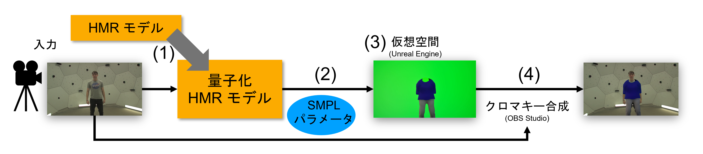

# research_repo_hmr

単眼RGB映像からのHuman Mesh Recovery（HMR）とUnreal Engineを連携させ、人物の動きに追従する映像演出を生成するコードです。

ROMP・SAT-HMR・Fast-SAM-3D-Bodyを対象に、推定精度と推論速度を比較し、量子化による高速化を検討します。推定した姿勢はSMPLに基づく共通形式へ変換し、UE上の人体・衣装・仮想物体の駆動に使用します。

## 目次

- [システム概要](#システム概要)
- [各ディレクトリの内容の概要](#各ディレクトリの内容の概要)
- [モデル別の環境と実行](#モデル別の環境と実行)
- [UEパッケージを使用した動画の作成](#ueパッケージを使用した動画の作成)
- [精度・速度の評価](#精度速度の評価)
- [参照リポジトリ](#参照リポジトリ)
- [ライセンス](#ライセンス)

## システム概要



衣装の重畳、人物の周囲を回る球による遮蔽表現、落下する岩と人体の衝突表現を扱います。

## 各ディレクトリの内容の概要

| ディレクトリ | 内容 |
|---|---|
| [ue/](ue/) | UEパッケージを使った動画推論・録画・実写との合成（UEプロジェクトはGitHub Releasesで配布） |
| [romp/](romp/) | ROMPの改変版。bf16化、torch.compile、UEへの姿勢送信 |
| [sat-hmr/](sat-hmr/) | SAT-HMRの改変版。bf16化・INT8量子化、torch.compile、TensorRT、UEへの姿勢送信 |
| [fast-sam-3d-body/](fast-sam-3d-body/) | Fast-SAM-3D-Bodyの改変版。bf16化・INT8量子化（TensorRT）、torch.compile、MHR→SMPL変換、UEへの姿勢送信 |
| [measurements/](measurements/) | 論文の計測（速度・精度・UE同時実行）、集計、図の生成 |

以下の手順でファイルを配置した後の構成は次のとおりです。

```text
research_repo_hmr/
├── body_models/smpl/
│   ├── SMPL_NEUTRAL.pkl
│   ├── SMPL_MALE.pkl
│   ├── SMPL_FEMALE.pkl
│   ├── SMPL_NEUTRAL.pth
│   ├── SMPL_FEMALE.pth
│   ├── SMPL_MALE.pth
│   ├── SMPLA_NEUTRAL.pth
│   ├── smpl_mean_params.npz
│   ├── body_verts_smpl.npy
│   ├── J_regressor_h36m_correct.npy
│   ├── J_regressor_extra.npy
│   ├── J_regressor_h36m.npy
│   └── smpl_kid_template.npy
├── checkpoints/moge2/
│   └── model.pt
├── sat-hmr/weights/sat_hmr/
│   ├── sat_644.pth
│   ├── sat_644_bf16.pth
│   ├── sat_644_int8w.pth
│   ├── sat_644_3dpw.pth
│   └── sat_644_3dpw_int8w.pth
├── romp/trained_models/
│   ├── ROMP_HRNet32_V1.pkl
│   ├── ROMP_HRNet32_V1_bf16.pth
│   └── ROMP_ResNet50_V1.pkl
├── fast-sam-3d-body/
│   ├── checkpoints/
│   │   ├── sam-3d-body-dinov3/
│   │   │   ├── model.ckpt
│   │   │   ├── assets/mhr_model.pt
│   │   │   └── backbone_trt/backbone_dinov3_int8.engine
│   │   ├── yolo/
│   │   │   ├── yolo11m-pose.pt
│   │   │   └── yolo11m-pose.engine
│   │   └── moge_trt/
│   │       └── moge_dinov2_encoder_int8.engine
│   └── mhr2smpl/
│       ├── experiments/multiview_n30000_e500/
│       └── data/
│           ├── mhr2smpl_mapping.npz
│           └── mhr_face_mask.ply
└── datasets/
    ├── 3dpw/
    │   ├── imageFiles/
    │   ├── sequenceFiles/
    │   ├── annots.npz
    │   ├── vibe_db/
    │   ├── annots_smpl_train_genders.npz
    │   └── annots_smpl_test_genders.npz
    ├── videos/
    │   └── sample_video.mp4
    └── cmu_panoptic/
        └── person_clips/
```


## モデル別の環境と実行

使用した環境は、モデルごとの `environment.yml` から作成します。

```bash
conda env create -f romp/environment.yml              # 環境名 romp_3.9
conda env create -f sat-hmr/environment.yml           # 環境名 sathmr-copy
conda env create -f fast-sam-3d-body/environment.yml  # 環境名 sam_3d_body
```

`romp_3.9` には pytorch3d を、`sathmr-copy`・`sam_3d_body` には chumpy（SMPLの読み込みに使用）を別に入れます。どちらも通常のpipのビルドでは入らないため `--no-build-isolation` を付けます。`sam_3d_body` には、さらに detectron2 を指定のコミットから入れます。pytorch3d はソースからビルドするため、CUDA 11.8 の `nvcc` が必要です（ビルドに10分以上かかります）。

```bash
conda activate romp_3.9
CUDA_HOME=/usr/local/cuda-11.8 FORCE_CUDA=1 python -m pip install --no-build-isolation "git+https://github.com/facebookresearch/pytorch3d.git@0a59450f0ebbe12d9a8db3de937814932517633b"

conda activate sathmr-copy
python -m pip install --no-build-isolation chumpy==0.70

conda activate sam_3d_body
python -m pip install --no-build-isolation chumpy==0.70
python -m pip install --no-build-isolation "git+https://github.com/facebookresearch/detectron2.git@a1ce2f956a1d2212ad672e3c47d53405c2fe4312"
```

chumpyにはPython 3.11・NumPyとの互換修正が必要です。両方の環境に[互換修正手順](sat-hmr/docs/fix_chumpy.md)を適用します。

### モデルの取得と配置


| ファイル | 取得元 | 配置先 |
|---|---|---|
| SAT-HMR `sat_644.pth` | [SAT-HMR公式配布](https://huggingface.co/ChiSu001/SAT-HMR/tree/main/weights/sat_hmr) | `sat-hmr/weights/sat_hmr/sat_644.pth` |
| SMPL male / female | [SMPL公式サイト](https://smpl.is.tue.mpg.de/) | `body_models/smpl/SMPL_MALE.pkl`、`SMPL_FEMALE.pkl` |
| SMPL neutral | [SMPLify公式サイト](http://smplify.is.tue.mpg.de/) | `body_models/smpl/SMPL_NEUTRAL.pkl` |
| SMPL補助データ | [SAT-HMR公式のGoogle Drive](https://drive.google.com/drive/folders/1wmd_pjmmDn3eSl3TLgProgZgCQZgtZIC?usp=sharing) | 同フォルダに `smpl_mean_params.npz`、`body_verts_smpl.npy`、`J_regressor_h36m_correct.npy` |
| MoGe-2 ViT-S normal `model.pt` | [MoGe公式モデル配布](https://huggingface.co/Ruicheng/moge-2-vits-normal/tree/main) | `checkpoints/moge2/model.pt` |

SMPLは各公式サイトからダウンロードし、次のように名前を変えて置きます。

| ダウンロードしたファイル | 配置するファイル名 |
|---|---|
| `basicModel_m_lbs_10_207_0_v1.0.0.pkl` | `SMPL_MALE.pkl` |
| `basicModel_f_lbs_10_207_0_v1.0.0.pkl` | `SMPL_FEMALE.pkl` |
| `basicModel_neutral_lbs_10_207_0_v1.0.0.pkl` | `SMPL_NEUTRAL.pkl` |

```bash
mkdir -p body_models/smpl
mv /path/to/basicModel_m_lbs_10_207_0_v1.0.0.pkl body_models/smpl/SMPL_MALE.pkl
mv /path/to/basicModel_f_lbs_10_207_0_v1.0.0.pkl body_models/smpl/SMPL_FEMALE.pkl
mv /path/to/basicModel_neutral_lbs_10_207_0_v1.0.0.pkl body_models/smpl/SMPL_NEUTRAL.pkl
```

### 量子化などで作成した重みの取得

論文で使用したbf16・INT8の重みとTensorRTエンジンは、リポジトリのルートで次を実行すると、各モデルが読み込む場所に配置されます。自分で作成する場合は[計測用の重みの作成](#計測用の重みの作成)を参照してください。

```bash
python download_weights.py            # 全モデル
python download_weights.py sathmr     # モデルを指定（sathmr / romp / fastsam）
```

| モデル | ファイル | 配置先 |
|---|---|---|
| SAT-HMR | `sat_644_bf16.pth`、`sat_644_int8w.pth`、`sat_644_3dpw_int8w.pth` | `sat-hmr/weights/sat_hmr/` |
| ROMP | `ROMP_HRNet32_V1_bf16.pth`、`ROMP_ResNet50_V1_bf16.pth`、`ROMP_HRNet32_V1_hrnet32_backbone_int8wo.pth`、`ROMP_ResNet50_V1_int8_raw_weights.pth` | `romp/trained_models/` |
| Fast-SAM-3D-Body | `backbone_dinov3_int8.engine` | `fast-sam-3d-body/checkpoints/sam-3d-body-dinov3/backbone_trt/` |
| | `moge_dinov2_encoder_int8.engine` | `fast-sam-3d-body/checkpoints/moge_trt/` |
| | `yolo11m-pose.engine` | `fast-sam-3d-body/checkpoints/yolo/` |
| | `model_bf16.ckpt`、`mhr_model_bf16.pt`、`model_bf16.pt` | `fast-sam-3d-body/checkpoints/bf16/` |

### 3DPWの配置

精度評価に使う3DPWは　`datasets/3dpw/` に置きます。[3DPW公式サイト](https://virtualhumans.mpi-inf.mpg.de/3DPW/)から `imageFiles` と `sequenceFiles` を取得し、各モデルの評価に必要な前処理済みの注釈ファイルを同じフォルダに加えます。

```text
datasets/3dpw/
  imageFiles/
  sequenceFiles/
  annots.npz, vibe_db/                  # ROMP
  annots_smpl_{train,test}_genders.npz  # SAT-HMR
```

ROMPの注釈ファイルは [romp/docs/dataset.md](romp/docs/dataset.md)、SAT-HMRの注釈ファイルは [sat-hmr/docs/data_preparation.md](sat-hmr/docs/data_preparation.md) の手順で用意します。

### 速度計測の入力動画の配置

[動画ACの素材](https://video-ac.com/video/1201)のHDサイズ（1280×720）をダウンロードし、`datasets/videos/sample_video.mp4` として置きます。

### CMU Panoptic Studioの動画の配置

論文の図・UEのデモでは、[CMU Panoptic Studio](https://github.com/CMU-Perceptual-Computing-Lab/panoptic-toolbox) のHD映像（カメラ `hd_00_00`）から、人物が1人だけ映っている15秒を切り出した次の動画を使用しました。pose2_p02 は概要図（図1・図4(A)）、残りの8本はデモに使用しています。

| 名前 | シーケンス |
|---|---|
| pose1_p01 | `171026_pose1` |
| pose2_p01 | `171204_pose2` |
| pose2_p02 | `171204_pose2` |
| pose2_p07 | `171204_pose2` |
| pose3_p01 | `171204_pose3` |
| pose3_p02 | `171204_pose3` |
| pose4_p01 | `171204_pose4` |
| pose4_p03 | `171204_pose4` |
| pose5_p03 | `171204_pose5` |

次のコマンドでHD映像を取得し、`datasets/cmu_panoptic/person_clips/` に切り出します。

```bash
python measurements/cmu_panoptic/make_person_clips.py
```

### ROMP

[学習済みモデル](https://github.com/Arthur151/ROMP#installation)と[SMPLモデルデータ](https://github.com/Arthur151/ROMP#installation)を取得し、次の場所へ配置します。モデル、数値精度、コンパイルの条件は `measurements/romp/configs/` のYAMLとコマンド引数で指定します。

| ファイル | 配置先 |
|---|---|
| 学習済みモデル `ROMP_HRNet32_V1.pkl`、`ROMP_ResNet50_V1.pkl` | `romp/trained_models/`（YAMLの `model_path` から参照） |

ROMPは `SMPL_NEUTRAL.pkl` をそのままでは読めず、ROMP専用の形式に変換した `SMPL_NEUTRAL.pth` を読みます。変換は最初に一度だけ行います。

1. [SMPLの配置](#モデルの取得と配置)のとおり、`body_models/smpl/` に `SMPL_NEUTRAL.pkl` を置きます。
2. [ROMPの配布ページ](https://github.com/Arthur151/ROMP#installation)から `smpl_model_data.zip` を取得し、中の `J_regressor_extra.npy`、`J_regressor_h36m.npy`、`smpl_kid_template.npy` を同じ `body_models/smpl/` に置きます。変換に使う補助データです。
3. 次のコマンドで、`body_models/smpl/` の `SMPL_{NEUTRAL,FEMALE,MALE}.pkl` と補助データから、ROMP用の `SMPL_NEUTRAL.pth`・`SMPL_FEMALE.pth`・`SMPL_MALE.pth`（と `SMPLA_*.pth`）を同じフォルダに作ります。`SMPL_FEMALE.pth`・`SMPL_MALE.pth` は3DPWの精度評価で使います（元の手順は [romp/docs/installation.md](romp/docs/installation.md)）。

```bash
conda activate romp_3.9
for gender in neutral female male; do
  python -c "import runpy, sys; sys.argv = ['pack', '-source_dir=$PWD/body_models/smpl', '--save_dir=$PWD/body_models/smpl', '--gender=$gender']; runpy.run_path('romp/simple_romp/romp/pack_smpl_info.py')['main']()"
done
```

bf16の重み（`ROMP_HRNet32_V1_bf16.pth`、`ROMP_ResNet50_V1_bf16.pth`）は[量子化などで作成した重みの取得](#量子化などで作成した重みの取得)のとおり取得します。自分で作る場合は[計測用の重みの作成](#計測用の重みの作成)を参照してください。

```bash
conda activate romp_3.9
cd romp
PYTHONPATH="$PWD:$PWD/romp" PYOPENGL_PLATFORM=egl python romp_video_demo.py \
  --input /path/to/input.mp4 \
  --configs_yml ../measurements/romp/configs/romp_video_fp32_no_compile.yml \
  --no_render --no_save
```

`--metrics_csv` を指定するとフレームごとの推論時間を出力します。論文のROMP速度評価はこのスクリプトで計測しています。

| ファイル | 内容 |
|---|---|
| [romp/romp_video_demo.py](romp/romp_video_demo.py) | 動画入力のベンチマーク用デモ |
| `romp/tools/export_quantized_weights_romp.py` | 量子化重みのエクスポート |

### SAT-HMR

SAT-HMRの重みとSMPLモデルは[モデルの取得と配置](#モデルの取得と配置)のとおりです。評価に使う3DPWは[3DPWの配置](#3dpwの配置)のとおりです。

```bash
conda activate sathmr-copy
cd sat-hmr
python video_demo.py \
  --input /path/to/input.mp4 \
  --weights weights/sat_hmr/sat_644.pth \
  --no_render --no_save
```

量子化、コンパイル、UDP配信などの条件は `python video_demo.py --help` で確認してください。論文のSAT-HMRの速度・精度はこのスクリプトで計測しています。

| ファイル | 内容 |
|---|---|
| [sat-hmr/video_demo.py](sat-hmr/video_demo.py) | PyTorchによる動画推論。SMPL姿勢のUEへのUDP送信と描画 |
| `sat-hmr/video_demo_trt.py` | TensorRT版 |
| `sat-hmr/webcam_demo_trt.py` | Webカメラでの実時間推論（TensorRT） |
| `sat-hmr/models/int8_attention.py`、`static_int8_fused.py` | INT8量子化の中核 |
| [sat-hmr/tools/](sat-hmr/tools/) | 量子化、ONNX/TensorRTエクスポート、キャリブレーション、TensorRTでの3DPW評価 |
| `sat-hmr/configs/run/eval_3dpw_*.yaml`、`train_qat.yaml` | 3DPW評価・QATの設定 |

### Fast-SAM-3D-Body

次の重みを取得して配置します（MoGe-2は初回実行時に自動で取得されます）。

| ファイル | 取得元 | 配置先 |
|---|---|---|
| SAM 3D Body（DINOv3）`model.ckpt`、`assets/mhr_model.pt` | [facebook/sam-3d-body-dinov3](https://huggingface.co/facebook/sam-3d-body-dinov3)（利用申請が必要） | `fast-sam-3d-body/checkpoints/sam-3d-body-dinov3/` |
| YOLO11 Pose `yolo11m-pose.pt` | [Ultralytics](https://github.com/ultralytics/assets/releases/download/v8.3.0/yolo11m-pose.pt) | `fast-sam-3d-body/checkpoints/yolo/` |
| MHR→SMPL変換モデル（`best_model.pth`、`sample_idx.npy` など） | [元のリポジトリ](https://github.com/yangtiming/Fast-SAM-3D-Body/tree/49b0fe0/mhr2smpl/experiments)の `mhr2smpl/experiments/` | `fast-sam-3d-body/mhr2smpl/experiments/` |
| `mhr2smpl_mapping.npz`、`mhr_face_mask.ply` | [MHR](https://github.com/facebookresearch/MHR)の `tools/mhr_smpl_conversion/assets/` | `fast-sam-3d-body/mhr2smpl/data/` |

論文で使用したTensorRTエンジンは[量子化などで作成した重みの取得](#量子化などで作成した重みの取得)のとおり取得できます。エンジンは作成したGPU・TensorRTのバージョンでのみ読み込めるため、環境が異なる場合は [fast-sam-3d-body/README.md](fast-sam-3d-body/README.md#tensorrtエンジンの作成) の手順で作成します。

UEへの配信には `run_publisher_ue.py` を使用します。SMPLモデル、MHR→SMPL変換モデル、対応表などの指定は `python run_publisher_ue.py --help` で確認してください。速度計測と精度評価は[精度・速度の評価](#精度速度の評価)のスクリプトで行います。

| ファイル | 内容 |
|---|---|
| [fast-sam-3d-body/run_publisher_ue.py](fast-sam-3d-body/run_publisher_ue.py) | リアルタイムSMPLパブリッシャ。ZMQ配信に加え、UEへUDP/TCP送信。INT8/TensorRTバックボーン・CUDA Graph・compileを環境変数で制御。論文のINT8 TensorRT・UE連携時の速度計測で使用 |
| `fast-sam-3d-body/mocap/realtime/ue_sender.py` | `run_publisher_ue.py` が使うUE送信モジュール |
| `fast-sam-3d-body/build_tensorrt.sh`、`convert_backbone_tensorrt.py`、`convert_moge_encoder_trt.py`、`convert_yolo_pose_trt.py`、`sam_3d_body/models/backbones/dinov3_tensorrt.py` | TensorRT変換 |
| [fast-sam-3d-body/mhr2smpl/multi_view/step0_infer_3dpw.py](fast-sam-3d-body/mhr2smpl/multi_view/step0_infer_3dpw.py) | 精度評価の入力となる3DPW推論サンプル（`sample_*.npz`）の生成 |

## UEパッケージを使用した動画の作成

入力動画の人物の姿勢をSAT-HMRで推定し、その姿勢で動かしたUE上の衣装や演出を元の動画に合成します。次の順に準備して実行します。

1. [環境の準備](#環境の準備)：`hmr` 環境を作る
2. [モデルの取得と配置](#モデルの取得と配置)：SAT-HMR・MoGe-2・SMPLの重みを置く
3. [UEパッケージの作成](#ueパッケージの作成)：演出を動かすUEの実行ファイルを作る
4. [実行と出力](#実行と出力)：動画を指定して実行する

### 環境の準備

リポジトリのルートで以下を実行します。

```bash
conda env create -f ue/environment.yml
conda activate hmr
python -m pip install --no-build-isolation chumpy==0.70
```

chumpyにはPython 3.11・NumPyとの互換修正が必要です。[互換修正手順](sat-hmr/docs/fix_chumpy.md)を作成した環境に適用し、次のコマンドで確認します。

```bash
python -c 'import torch, chumpy; from moge.model.v2 import MoGeModel; assert torch.cuda.is_available()'
```


### UEパッケージの作成

演出ごとのUEパッケージ（Normal：衣装の重畳、RockDrop：落下する岩、SphereOrbit：周囲を回る球）を作ります。パッケージにはSMPLの人体とSocketClientプラグインが入るため配布しておらず、GitHub Releasesで配布しているUEプロジェクトから各自で作成します。

必要なもの：

- Windows 10/11、Visual Studio 2022（C++によるゲーム開発ワークロード）
- Unreal Engine 5.5.4（[Epic Games Launcher](https://www.unrealengine.com/download)からインストール）
- UEプラグイン Simple TCP UDP Socket Client（作者 Socke、プラグイン名 `SocketClient`）。[Fab](https://www.fab.com/listings/d19071be-473f-4dcb-8a95-ced3eda6667d)で入手し、Epic Games Launcherで UE 5.5.4 に「エンジンにインストール」します
- [環境の準備](#環境の準備)で作成した `hmr` 環境（手順3で使用）

手順：

1. [Releases](https://github.com/gyantic/research_repo_hmr/releases/tag/ue-project-v1) から `ue-unreal-project.zip` を取得し、Windows上の任意のフォルダに展開します。展開すると `unreal` フォルダができます。

   ```powershell
   Expand-Archive ue-unreal-project.zip -DestinationPath C:\path\to\folder
   cd C:\path\to\folder\unreal
   ```

   以降は、この `unreal` フォルダをカレントディレクトリとしたWindows PowerShellのコマンドです。UEエディタは閉じた状態で実行します。

2. エディタ用モジュールをビルドします。

   ```powershell
   powershell -ExecutionPolicy Bypass -File Tools\build-editor.ps1
   ```

3. `SMPL_FEMALE.pkl` から人体のglTFを作成し、`unreal` フォルダの `Interchange/SMPL.glb` に書き出します。`hmr` 環境で、このリポジトリのルートから実行します。WSLから実行する場合、`unreal` フォルダは `/mnt/c/path/to/folder/unreal` のように指定します。

   ```bash
   conda activate hmr
   python /path/to/folder/unreal/Tools/SMPLSetup/smpl_to_gltf.py body_models/smpl/SMPL_FEMALE.pkl /path/to/folder/unreal/Interchange/SMPL.glb
   ```

4. glTFを `/Game/SMPL` としてインポートし、受信Blueprintの人体に設定します。

   ```powershell
   powershell -ExecutionPolicy Bypass -File Tools\import-smpl.ps1
   ```

5. 3つのパッケージを作成します。`Deliverables/{Normal,RockDrop,SphereOrbit}` に出力されます。

   ```powershell
   powershell -ExecutionPolicy Bypass -File Tools\package-recording.ps1
   ```

作成したパッケージはSMPLとSocketClientプラグインを含むため、再配布しないでください。生成される `Interchange/SMPL.glb`・`Content/SMPL.uasset`・`Content/SMPL_Skeleton.uasset` もSMPLを含むため同様です。

### 実行と出力

```bash
conda activate hmr
python ue/run_video.py --package /path/to/Normal --video /path/to/input.mp4
```

`--package` には、作成したパッケージのフォルダ（`Deliverables/Normal`・`RockDrop`・`SphereOrbit` のいずれか）を指定します。指定したパッケージの演出で、合成した動画が次の場所に出力されます。

```text
results/ue/<Normal・RockDrop・SphereOrbit>/Recordings/<実行日時>/composite/final.mp4
```

出力先は `--output` で変更できます。

### SAT-HMR（INT8）からUEへの実時間送信

SAT-HMR（INT8）の推定姿勢をUDPでUEへ送り、UE上の人体を動かします。論文の図5の計測と同じ構成です。

1. [UEパッケージの作成](#ueパッケージの作成)の手順1〜4を行います（手順5のパッケージ作成は不要です）。
2. INT8の重み `sat_644_int8w.pth` を取得します。

   ```bash
   python download_weights.py sathmr
   ```

3. Windows PowerShellで、UEプロジェクトをゲームモードで起動します。起動したマップの受信Blueprint（`BP_UDPBoneBasedReceiver1`）が、ポート62004で姿勢を受信します。

   ```powershell
   & "C:\Program Files\Epic Games\UE_5.5\Engine\Binaries\Win64\UnrealEditor.exe" "C:\path\to\folder\unreal\MyProject_ROMP.uproject" -game -windowed -ResX=1280 -ResY=720
   ```

4. UEのウィンドウが開いたら、リポジトリのルートで次を実行します。UEからの接続（HELLO）を受けると送信を始め、`datasets/videos/sample_video.mp4` の全フレームを送ります。

   ```bash
   conda activate sathmr-copy
   bash measurements/sathmr/run.sh udp
   ```

入力動画は環境変数 `VIDEO` で変更できます。フレームごとの推論時間は `results/measurements/rerun_<実行日時>/raw_sathmr_udp_int8w_dynamic_compile_no_int8_attn.csv` に出力されます。

## 精度・速度の評価

[モデル別の環境と実行](#モデル別の環境と実行)の準備に加え、[量子化などで作成した重みの取得](#量子化などで作成した重みの取得)で重みを取得するか、次の手順で作成してから実行します。

### 計測用の重みの作成

ROMPのbf16重み（`romp_3.9` 環境、`romp/` から実行）：

```bash
python tools/export_quantized_weights_romp.py --input trained_models/ROMP_HRNet32_V1.pkl --output trained_models/
```

SAT-HMR（`sathmr-copy` 環境、`sat-hmr/` から実行）。精度評価用の `sat_644_3dpw.pth` も[SAT-HMR公式配布](https://huggingface.co/ChiSu001/SAT-HMR/tree/main/weights/sat_hmr)から取得して同じフォルダに置きます。

```bash
python -c "import torch; sd = torch.load('weights/sat_hmr/sat_644.pth', map_location='cpu'); torch.save({k: v.to(torch.bfloat16) for k, v in sd.items()}, 'weights/sat_hmr/sat_644_bf16.pth')"
python tools/quantize_weights_int8.py --input weights/sat_hmr/sat_644.pth --output weights/sat_hmr/sat_644_int8w.pth
python tools/quantize_weights_int8.py --input weights/sat_hmr/sat_644_3dpw.pth --output weights/sat_hmr/sat_644_3dpw_int8w.pth
```

### 計測の実行と論文の図

Normalパッケージを先に起動しておき（図5の計測に使用）、リポジトリのルートから実行します。リポジトリ直下に `paper_results.csv` が作成されます。

```bash
bash measurements/run_all.sh
```

論文の図は `results_png/` に出力されます。

```bash
python measurements/paper_figures/plot_speed_vs_accuracy.py         # 図2
python measurements/paper_figures/plot_sathmr_int8_compile_scope.py # 図3
python measurements/paper_figures/plot_udp_overhead.py              # 図5
```

脚注1の値は `results/measurements/rerun_<日時>/` の `accuracy_fastsam_fp32/metrics_paper_3dpw14.json`（`PA-MPJPE`）と `accuracy_sathmr_fp32.txt`（`PAPER-PA-MPJPE`）に出ます。

## 参照リポジトリ

以下の3個のリポジトリを元としています。

| モデル | 元のリポジトリ | 改変元コミット | 元のREADME |
|---|---|---|---|
| ROMP | [Arthur151/ROMP](https://github.com/Arthur151/ROMP) | `a8558ae` | [romp/README_UPSTREAM.md](romp/README_UPSTREAM.md) |
| SAT-HMR | [ChiSu001/SAT-HMR](https://github.com/ChiSu001/SAT-HMR) | `7b157fa` | [sat-hmr/README_UPSTREAM.md](sat-hmr/README_UPSTREAM.md) |
| Fast-SAM-3D-Body | [yangtiming/Fast-SAM-3D-Body](https://github.com/yangtiming/Fast-SAM-3D-Body) | `49b0fe0` | [fast-sam-3d-body/README_UPSTREAM.md](fast-sam-3d-body/README_UPSTREAM.md) |

## ライセンス

このリポジトリ全体に単一のライセンスはありません。各ディレクトリのコードは、下表のライセンスに従います。モデルの重み・データセットは、それぞれの配布元の条件に従って取得してください。

### コード

| 対象 | ライセンス |
|---|---|
| [romp/](romp/) | Apache License 2.0（[romp/LICENSE.md](romp/LICENSE.md)）。`romp/simple_romp/` は MIT License |
| [sat-hmr/](sat-hmr/) | Apache License 2.0（[sat-hmr/LICENSE](sat-hmr/LICENSE)） |
| [fast-sam-3d-body/](fast-sam-3d-body/) | MIT License（[fast-sam-3d-body/LICENSE](fast-sam-3d-body/LICENSE)） |
| [ue/](ue/)、[measurements/](measurements/)（本研究で作成したコード） | Apache License 2.0（[ue/LICENSE](ue/LICENSE)、[measurements/LICENSE](measurements/LICENSE)） |

### モデル・重み

| 対象 | ライセンス・条件 |
|---|---|
| SMPL | [SMPL Model License](https://smpl.is.tue.mpg.de/modellicense.html)（非商用の研究目的のみ。再配布不可） |
| SAM 3D Body のチェックポイント | SAM License |
| DINOv3 | [DINOv3 License](https://github.com/facebookresearch/dinov3) |
| MoGe / MoGe-2 | MIT License（[MoGe](https://github.com/microsoft/MoGe)、[moge-2-vits-normal](https://huggingface.co/Ruicheng/moge-2-vits-normal)） |
| MHR | Apache License 2.0（[MHR](https://github.com/facebookresearch/MHR)） |
| YOLO11（ultralytics） | AGPL-3.0 |

### データ

| 対象 | ライセンス・条件 |
|---|---|
| 3DPW | [3DPW のライセンス](https://virtualhumans.mpi-inf.mpg.de/3DPW/license.html)（非商用の研究目的のみ。第三者への提供不可） |
| CMU Panoptic Studio | [panoptic-toolbox](https://github.com/CMU-Perceptual-Computing-Lab/panoptic-toolbox) に記載の条件（非商用・研究目的のみ。利用時は論文を引用） |
| 速度計測の入力動画 | [動画AC利用規約](https://video-ac.com/terms)（商用利用・加工可。単独での再配布不可） |

データはいずれもリポジトリに含めていません。CMU Panoptic Studio は[CMU Panoptic Studioの動画の配置](#cmu-panoptic-studioの動画の配置)の9本のクリップのみを使用しています。

### UEプロジェクト（GitHub Releases）

| 対象 | ライセンス・条件 |
|---|---|
| UEプロジェクト・StarterContent | Unreal Engine EULA |
| SocketClient プラグイン | Fab の利用条件（プロジェクトには含めず、各自で取得） |
| 衣装（シャツ・ズボン） | CC BY 4.0（クレジットは [ue/README.md](ue/README.md#同梱素材のクレジット)） |
